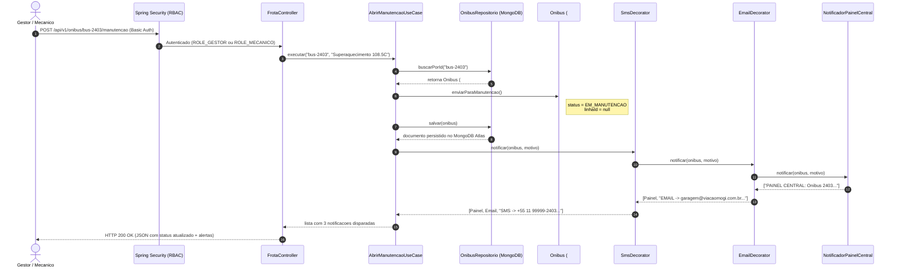

[readme_md_do_projeto_frotam2.md](https://github.com/user-attachments/files/35435291/readme_md_do_projeto_frotam2.md)
# 🚌 FrotaM2 — Sistema de Gestão de Frota de Ônibus (Grupo G13)

Aplicação web e API REST para gestão operacional de frota de ônibus urbanos, com monitoramento de telemetria GPS em tempo real, alocação por linhas, disparo de alertas de manutenção em cadeia via padrão **Decorator** (Java puro), controle de acesso baseado em papéis (**Spring Security**), persistência NoSQL no **MongoDB Atlas** e deploy contínuo em container **Docker** no **Render**.

> **Autor / Grupo:** Raphael Santana • Grupo G13  
> **Disciplina:** Engenharia de Software / Arquitetura e Padrões de Projeto

---

## 🌐 Links em Produção (Nuvem)

* **Painel Operacional FrotaM2:** https://gestao-frota-bhw1.onrender.com
* **Documentação Interativa da API (Swagger UI):** https://gestao-frota-bhw1.onrender.com/swagger-ui/index.html
* **Repositório GitHub:** https://github.com/raphaelsantana2003-gif/gestao-frota

> ⚠️ **Nota sobre o plano gratuito do Render:** a instância entra em hibernação após 15 minutos sem acessos. Caso o primeiro carregamento leve cerca de 40 a 50 segundos, aguarde o despertar automático do container; após isso, todas as requisições respondem instantaneamente.

---

## 🔐 Credenciais de Demonstração (Spring Security — RBAC)

A API utiliza autenticação **HTTP Basic Auth** em modo `STATELESS`, com senhas protegidas por `BCryptPasswordEncoder` e controle de acesso por papel:

| Perfil | Usuário | Senha | Permissões |
| :--- | :--- | :--- | :--- |
| **GESTOR** | `gestor` | `gestor123` | Acesso total: consultar frota e linhas, cadastrar ônibus/linhas, alocar veículos e abrir manutenção. |
| **MECÂNICO** | `mecanico` | `mecanico123` | Acesso restrito: consultar frota/linhas e abrir manutenção (bloqueado com `403 Forbidden` ao tentar cadastrar ou alocar). |

---

## 🛠️ Stack Tecnológica

* **Back-end:** Java 21, Spring Boot 3.3.5, Spring Web, Spring Security, Spring Data MongoDB
* **Documentação da API:** Springdoc OpenAPI 3 (Swagger UI)
* **Banco de Dados (NoSQL):** MongoDB Atlas (`Cluster0` / base `db_frota_onibus`)
* **Testes Automatizados:** JUnit 5 + Mockito
* **Front-end:** HTML5, CSS3 e JavaScript puro conectado em tempo real à API REST (com Monitor HTTP ao vivo)
* **Infraestrutura / DevOps:** Docker (multi-stage build), GitHub e Render (HTTPS + Deploy Contínuo)

---

## 🏗️ Arquitetura e Requisitos de Engenharia de Software

O projeto segue uma arquitetura em camadas inspirada em **Ports & Adapters (Arquitetura Hexagonal)**, mantendo o núcleo do domínio 100% em Java puro, desacoplado do Spring e do MongoDB:

```text
src/
├── main/
│   ├── java/br/com/frota/
│   │   ├── domain/                # Entidades, Value Objects e regras de negócio puras
│   │   │   ├── notification/      # Padrão Decorator em Java puro (sem framework)
│   │   │   └── port/              # Portas (Interfaces DIP: Repositórios e EnviadorEmail)
│   │   ├── application/           # Casos de uso (AbrirManutencaoUseCase)
│   │   └── infrastructure/        # Adaptadores MongoDB, Spring Security, Config/Seeder e Controller REST
│   └── resources/
│       ├── application.properties # Configuração segura via variáveis de ambiente (${PORT}, ${MONGODB_URI})
│       └── static/index.html      # Painel web interativo + Monitor HTTP REST
└── test/
    └── java/br/com/frota/
        └── FrotaTest.java         # Suíte de 5 testes unitários isolados (JUnit 5 + Mockito)
```

### Princípios e Padrões Aplicados

* **Decorator (Java puro, sem framework):** implementado em `br.com.frota.domain.notification`. O componente base `NotificadorPainelCentral` registra o alerta no painel e é envolvido dinamicamente por `EmailDecorator` e `SmsDecorator` através de `NotificadorDecorator` e `MontadorNotificador`. Isso evita explosão de subclasses e permite adicionar novos canais (como WhatsApp) sem alterar o caso de uso.
* **Demais Design Patterns (aplicados por necessidade real):**
  * **Ports & Adapters (Hexagonal) + Repository:** desacopla o domínio do banco MongoDB (`OnibusRepositorio` ← `MongoOnibusAdapter`).
  * **DTO (Records):** isola o contrato JSON da API REST das estruturas de persistência.
  * **Use Case / Factory:** `AbrirManutencaoUseCase` orquestra a manutenção e `ConfiguracaoApp` centraliza a montagem de dependências e o `DataSeeder` idempotente.
* **SOLID:**
  * **S (SRP):** cada classe possui responsabilidade única (`Placa` valida formato, `Onibus` protege invariantes, `FrotaController` traduz HTTP).
  * **O (OCP) e L (LSP):** qualquer pilha de `NotificadorManutencao` substitui outra transparentemente e novos canais entram por extensão.
  * **I (ISP):** interfaces enxutas e separadas em `domain.port` (`OnibusRepositorio`, `LinhaRepositorio`, `EnviadorEmail`).
  * **D (DIP):** o domínio e a camada de aplicação dependem apenas de abstrações; a infraestrutura implementa essas portas.
* **Calistenia de Objetos & Tell, Don't Ask:**
  * **Value Object (`Placa`):** valida automaticamente o padrão antigo e Mercosul (`^[A-Z]{3}[0-9][A-Z0-9][0-9]{2}$`) no construtor.
  * **First-Class Collection (`FrotaAlocada`):** encapsula listas imutáveis de ônibus alocados e fornece comportamentos de domínio (`contarEmOperacao()`).
  * **Tell, Don't Ask & Early Return (sem `else`):** a própria entidade `Onibus` valida seu estado em `alocarNaLinha()`, desvincula a linha em `enviarParaManutencao()` e delega a verificação de superaquecimento (`>= 100 °C`) em `estaSuperaquecendo()`.

---

## 🔗 Relacionamentos Modelados (NoSQL — MongoDB)

* **1:1 (Ônibus ↔ Telemetria GPS):** cada veículo possui um único `DispositivoTelemetria` (código GPS, temperatura do motor e nível de combustível). No MongoDB, foi modelado como **documento embutido** na coleção `onibus`, eliminando `JOINs` e permitindo evolução flexível de sensores (veículos a diesel, híbridos e elétricos).
* **1:N (Linha ↔ Ônibus):** uma `LinhaOnibus` (`L01 — E103`, `L02 — C207`) pode possuir vários ônibus, enquanto cada veículo opera em no máximo uma linha por vez (ou fica `Sem linha` em manutenção). Modelado por **referência via `linhaId`** entre as coleções `linhas_onibus` e `onibus`.

---

## 📐 Diagramas UML

### 1. Diagrama de Classes (Visão Estática)

```mermaid
classDiagram
    direction TB

    class LinhaOnibus {
        -String id
        -String codigo
        -String nome
        -double tarifa
    }

    class Onibus {
        -String id
        -String prefixo
        -Placa placa
        -String modelo
        -StatusOnibus status
        -String linhaId
        -DispositivoTelemetria telemetria
        +alocarNaLinha(String linhaId) void
        +enviarParaManutencao() void
        +estaSuperaquecendo() boolean
    }

    class Placa {
        <<record>>
        +String valor
    }

    class DispositivoTelemetria {
        -String codigoGps
        -double temperaturaMotor
        -int combustivel
        +estaSuperaquecendo() boolean
    }

    class FrotaAlocada {
        -List~Onibus~ onibus
        +listar() List~Onibus~
        +contarEmOperacao() long
    }

    class NotificadorManutencao {
        <<interface>>
        +notificar(Onibus onibus, String motivo) List~String~
    }

    class NotificadorPainelCentral {
        +notificar(Onibus onibus, String motivo) List~String~
    }

    class NotificadorDecorator {
        <<abstract>>
        #NotificadorManutencao envolvido
        +notificar(Onibus onibus, String motivo) List~String~
    }

    class EmailDecorator {
        -EnviadorEmail enviadorEmail
        +notificar(Onibus onibus, String motivo) List~String~
    }

    class SmsDecorator {
        +notificar(Onibus onibus, String motivo) List~String~
    }

    class OnibusRepositorio {
        <<interface>>
        +buscarPorId(String id) Optional~Onibus~
        +listarTodos() List~Onibus~
        +listarPorLinha(String linhaId) List~Onibus~
        +salvar(Onibus onibus) Onibus
        +contar() long
    }

    class LinhaRepositorio {
        <<interface>>
        +listarTodas() List~LinhaOnibus~
        +salvar(LinhaOnibus linha) LinhaOnibus
    }

    class EnviadorEmail {
        <<interface>>
        +enviar(String destino, String assunto, String corpo) void
    }

    class AbrirManutencaoUseCase {
        -OnibusRepositorio onibusRepositorio
        -NotificadorManutencao notificador
        +executar(String onibusId, String motivo) List~String~
    }

    class MongoOnibusAdapter
    class MongoLinhaAdapter

    Onibus "1" *-- "1" Placa : possui
    Onibus "1" *-- "1" DispositivoTelemetria : telemetria 1:1
    LinhaOnibus "0..1" -- "0..*" Onibus : alocacao 1:N
    FrotaAlocada o-- "0..*" Onibus : encapsula

    NotificadorPainelCentral ..|> NotificadorManutencao
    NotificadorDecorator ..|> NotificadorManutencao
    NotificadorDecorator o-- "1" NotificadorManutencao : envolve
    EmailDecorator --|> NotificadorDecorator
    SmsDecorator --|> NotificadorDecorator
    EmailDecorator --> EnviadorEmail : usa (DIP)

    AbrirManutencaoUseCase --> OnibusRepositorio : depende (DIP)
    AbrirManutencaoUseCase --> NotificadorManutencao : dispara
    AbrirManutencaoUseCase ..> Onibus : comanda (Tell, Don't Ask)

    MongoOnibusAdapter ..|> OnibusRepositorio
    MongoLinhaAdapter ..|> LinhaRepositorio
```

### 2. Diagrama de Sequência — Enviar Ônibus Superaquecido (`#2403`) para Manutenção



---

## 📡 Endpoints da API REST (`/api/v1`)

| Método | Endpoint | Permissão (RBAC) | Códigos HTTP | Descrição |
| :---: | :--- | :--- | :---: | :--- |
| `GET` | `/api/v1/onibus` | `GESTOR`, `MECANICO` | `200`, `401` | Lista toda a frota com telemetria 1:1 e alerta de superaquecimento. |
| `GET` | `/api/v1/linhas/{linhaId}/onibus` | `GESTOR`, `MECANICO` | `200`, `401` | Filtra veículos alocados na linha (relacionamento 1:N via `FrotaAlocada`). |
| `POST` | `/api/v1/onibus` | Somente `GESTOR` | `201`, `400`, `403` | Cadastra novo ônibus validando a placa pelo Value Object `Placa`. |
| `POST` | `/api/v1/linhas` | Somente `GESTOR` | `201`, `400`, `403` | Cadastra nova linha de transporte no MongoDB Atlas. |
| `PATCH` | `/api/v1/onibus/{id}/alocacao` | Somente `GESTOR` | `200`, `403`, `404`, `409` | Atualiza a linha do veículo; retorna **`409 Conflict`** se estiver em manutenção. |
| `POST` | `/api/v1/onibus/{id}/manutencao` | `GESTOR`, `MECANICO` | `200`, `404` | Move veículo para `EM_MANUTENCAO`, desvincula linha e dispara a cadeia Decorator. |

---

## 🧪 Testes Unitários Automatizados

A suíte `src/test/java/br/com/frota/FrotaTest.java` valida as regras críticas de forma 100% isolada e offline com **JUnit 5** e **Mockito**:

1. **Validação de Placa (Calistenia):** garante que placas inválidas (ex.: `ABC12`) lancem `IllegalArgumentException`.
2. **Proteção de Invariante (Tell, Don't Ask):** garante que ônibus em manutenção não possam ser alocados (`IllegalStateException` → HTTP `409`).
3. **Telemetria 1:1:** valida detecção automática de superaquecimento para motores a partir de `100.0 °C`.
4. **Padrão Decorator (LSP/OCP):** verifica o empilhamento de `NotificadorPainelCentral` + `EmailDecorator` + `SmsDecorator` e a chamada ao `EnviadorEmail` mockado.
5. **Caso de Uso (`AbrirManutencaoUseCase` — DIP):** valida mudança de status, limpeza de `linhaId` e chamada de persistência com `OnibusRepositorio` mockado.

Para executar a suíte de testes (não exige banco de dados nem internet):

```bash
# Windows (PowerShell)
.\mvnw.cmd test

# Linux / macOS
./mvnw test
```

---

## 💻 Como Executar Localmente

### Pré-requisitos
* **Java 21 (JDK 21)** instalado
* String de conexão válida do **MongoDB** (local ou MongoDB Atlas)

### Passo a passo

1. Clone o repositório:
   ```bash
   git clone https://github.com/raphaelsantana2003-gif/gestao-frota.git
   cd gestao-frota
   ```

2. Defina a variável de ambiente `MONGODB_URI` (nunca grave credenciais reais no `application.properties`):
   ```powershell
   # Windows (PowerShell)
   $env:MONGODB_URI="mongodb+srv://<usuario>:<senha>@<cluster>.mongodb.net/db_frota_onibus?retryWrites=true&w=majority"
   ```
   ```bash
   # Linux / macOS
   export MONGODB_URI="mongodb+srv://<usuario>:<senha>@<cluster>.mongodb.net/db_frota_onibus?retryWrites=true&w=majority"
   ```

3. Inicie a aplicação:
   ```powershell
   # Windows
   .\mvnw.cmd spring-boot:run
   ```
   ```bash
   # Linux / macOS
   ./mvnw spring-boot:run
   ```

4. Acesse no navegador:
   * Painel FrotaM2: `http://localhost:8080`
   * Swagger UI: `http://localhost:8080/swagger-ui/index.html`

> Na primeira execução (ou quando o banco estiver vazio), o `DataSeeder` popula automaticamente 2 linhas (`L01` e `L02`) e 4 ônibus (`#2400` a `#2403`).

---

## 🔄 Como Resetar os Dados para o Estado Inicial

1. No **MongoDB Atlas → Data Explorer**, expanda `Cluster0` e execute **Drop Database** apenas em `db_frota_onibus`.
2. No **Render** (ou localmente), acione **Manual Deploy → Deploy latest commit** (ou reinicie o servidor).
3. Ao subir e detectar a coleção vazia, o `DataSeeder` recria automaticamente o cenário inicial de demonstração.
